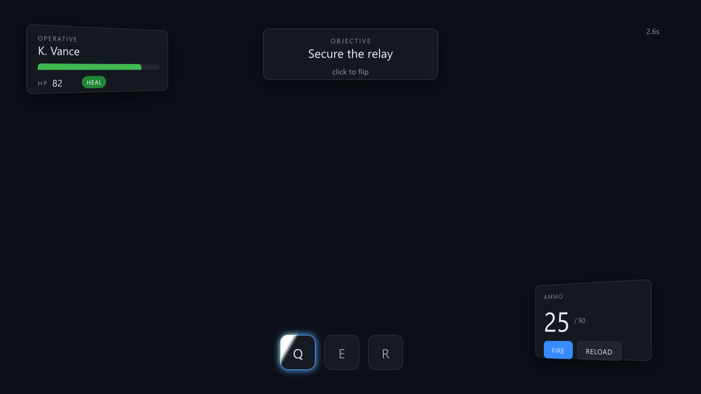
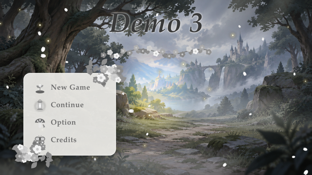
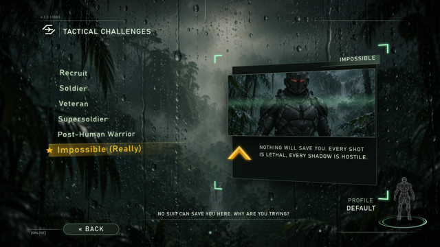
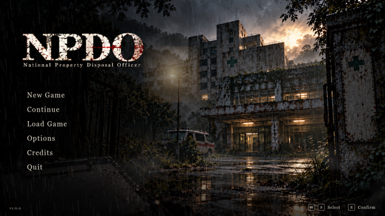
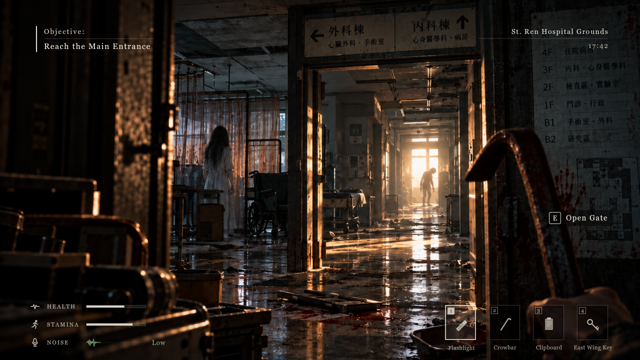

# Demos

Self-contained XTFrame documents that show the feature set working together. Each demo is a folder
with `.xt` documents, their `.xts` stylesheets and, where the demo is interactive, an `.xtflow`
signal graph that stands in for game code, so the demo runs without a host program.

## game-ui



A UI Project (`Docs/design/22-bundle.md` §22.11, `30-ui-project.md`) holding the two UIs one game
screen needs, both 1280x720 and both themed by `shared/base.xts`:

```
game-ui/
  XTFrame Game UI demo.xtui   the project file: id "demo-game", the UI list, the shared theme and the spec
  shared/base.xts        palette, type scale, panel and button base -- shared by both UIs
  shared/anim/*.json     Lottie animations (radar, alert) used by the HUD and the pause menu
  hud/hud.xt .xts .xtflow
  menus/pause.xt .xts
```

`shared/base.xts` is listed in the `.xtui` under `shared.styles`, so `xtframe-pack` loads it
before each UI's own stylesheet. Each `.xt` also `<link>`s it explicitly, so a single document
still looks right when it is opened on its own; loading the same rules twice changes nothing in
the cascade.

**hud** -- a game HUD:

- two panels tilted in 3D (`rotateY` inside their own `perspective` stage), each with a drop shadow;
- a health bar driven by the flow graph: a timer bleeds HP, `HEAL` resets it, the bar width and the
  number follow through `setStyle`/`setText`, and below 30 the panel gets the `danger` class;
- an ammo counter: `FIRE` decrements, `RELOAD` resets, and at zero the panel gets the `empty`
  class (red number, red glow, animated by `transition: effect`);
- a skill button with a glow and a shine sweep animated by `@keyframes` over the `effect` property;
- an objective card that spins on click (`toggleClass` + `transition`), and a running clock.

**Lottie** -- both UIs mix Lottie content (`Docs/design/11-lottie-mapping.md`) with the document:

- `shared/anim/radar.json` (a rotating sweep over two rings and a fading blip, 2 s) plays in a loop
  in the HUD's bottom-left corner (`<anim id="radar" loop="true">`, 96x96, `opacity: 0.8`). A flow
  `timer` flips its speed between 1.0 and 2.0 every 5 s through `#radar.setSpeed`.
- `shared/anim/alert.json` (a flashing warning triangle, markers `flash` at 0.5 s and `end` at
  1.0 s) sits next to `HEAL` with `autoplay="false"` and the `hidden` class. When HP drops below 30
  the flow removes `hidden` and sends `#alert.play`; `#alert.Finished` plays it again, so it
  flashes for as long as HP stays low; healing sends `#alert.pause` and hides it again. The
  Lottie-to-document direction is `#alert.Marker`: a `compare` (`Marker ne "end"`) adds the `flash`
  class to the player panel (red border) when marker `flash` arrives and removes it at marker
  `end`. (`ne "end"` rather than `eq "flash"`: before the first marker the compare sees its
  unset number input, which equals the string constant's number value, so `eq "flash"` would
  already be settled `true` and miss the first `flash`.)
- The pause menu shows the same `radar.json` beside `PAUSED` at `speed="0.5"`: one source file
  shared by two UIs. A Lottie file is not a runtime asset -- the compiler turns it into scene and
  timeline data inside each UI's `.xtir` (`Docs/design/12-compiler.md`), so the packed bundle has
  no `assets/` entry for it and needs no file next to the `.xtir` at run time.

**pause** -- the pause menu over the same scene: a scrim, a halo behind the panel whose glow
pulses through a `@keyframes` animation on the `effect` property, the `PAUSED` heading and the
Resume / Options / Quit buttons with `:hover` and `:active` states from the shared theme.

### Run it

The whole UI Project in the editor (needs Qt, see "Building the editor" in the top-level README):

```
bin/win_x64/Debug/xtframe-editor.exe "Examples/demos/game-ui/XTFrame Game UI demo.xtui"
```

The UI list above the document tree switches between `hud` and `pause`; **Demo** mode runs the
HUD's flow graph, and the shared rules are marked `shared` in the style rules panel.

Publish it as a Bundle, then browse or view the published form (CryEngine reads that folder
directly from `<game>/ui/demo-game/`):

```
cmake --build --preset vs2022-editor-debug --parallel --target xtframe-pack xtframe-browse
bin/win_x64/Debug/xtframe-pack.exe Examples/demos/game-ui -o build/game-ui
bin/win_x64/Debug/xtframe-browse.exe build/game-ui
bin/win_x64/Debug/xtframe-view.exe build/game-ui --ui hud
```

`xtframe-view Examples/demos/game-ui --ui hud` does the same without the explicit publish: it packs
the UI Project to `%TEMP%/xtframe-view/` first.

A single UI still plays in the standalone player, which needs only the default build:

```
cmake --preset vs2022
cmake --build --preset vs2022-release --parallel --target xtframe-view
bin/win_x64/Release/xtframe-view.exe Examples/demos/game-ui/hud/hud.xt --flow Examples/demos/game-ui/hud/hud.xtflow --width 1280 --height 720
```

### How it was made

The HUD was authored by an AI agent through Marionette, the developer endpoint described in
`Docs/design/20-agent-interface.md`, starting from an empty `<div id="root">`. The three batches
are kept next to the result and can be replayed against a fresh skeleton:

```
cmake --preset vs2022-agent && cmake --build --preset vs2022-agent-debug --parallel --target xtframe-editor
Tools/Scripts/xa.sh start <copy of a skeleton hud.xt>
Tools/Scripts/xa.sh time.pause
Tools/Scripts/xa.sh -f Examples/demos/game-ui/build.marionette.json    # elements
Tools/Scripts/xa.sh -f Examples/demos/game-ui/style.marionette.json    # rules and @keyframes
Tools/Scripts/xa.sh -f Examples/demos/game-ui/flow.marionette.json     # signal graph
Tools/Scripts/xa.sh session.save
Tools/Scripts/xa.sh stop
```

The batches predate the split into `shared/base.xts`, so replaying them rebuilds the HUD with the
theme rules inlined in `hud.xts`.

### Workarounds in this demo (engine gaps found while building it)

- Sizes are explicit pixels: percentage heights and auto-sized absolutely positioned boxes are
  being fixed in T-74.
- The card uses `transition: all`; `transition: transform` is rejected because `transform` is a
  shorthand.

### Opening an imported design

`xtframe-import` (see "Import from Figma" in the top-level `README.md`) writes exactly the layout this
demo has: a UI Project with its `<name>.xtui`, one `<ui>/<ui>.xt` per frame and a shared
stylesheet. So an import opens, previews and publishes with the same three commands:

```
bin/win_x64/Debug/xtframe-import.exe figma <dump-dir> -o build/imported
bin/win_x64/Debug/xtframe-editor.exe build/imported
bin/win_x64/Debug/xtframe-pack.exe build/imported -o build/imported-pack --no-thumbs
```

The editor is where the static import becomes a UI: add the animations, effects and connection
points, and check `import-report.json` for the nodes that came in as rasterized PNGs or with
warnings. Re-running the import afterwards keeps those edits -- it merges, and stops with exit code
3 on anything both you and the designer changed.

## mobile-hud

A portrait UI Project for phones (`Docs/design/23-host-integration.md` §23.11.2) built only from
the standard symbol library's `mobile/` subset and its tokens:

```
mobile-hud/
  Mobile HUD demo.xtui   spec: platform "mobile" (1080x2400, 1170x2532, 2560x1600), safe area 4%,
                         logicalHeight 1080, uiscaleRule shortEdge (uiscale = short edge / 1080)
  shared/tokens.xts      the standard tokens (Assets/Symbols/tokens.xts), touch sizes included
  ui/hud/                TopBar (pause, HealthBar, ammo Counter), minimap <external>, VirtualJoystick
                         bottom-left, Jump / Attack TouchButtons bottom-right; `intro` on show and
                         a cooldown ring timeline per button press
  ui/settings/           a BottomSheet holding a TabBar, two ToggleTouch rows and a SliderTouch
```

`xtframe-pack "Examples/demos/mobile-hud"` copies the linked standard symbols into
`shared/symbols/` and packs both UIs with no diagnostics; then
`xtframe-view "Examples/demos/mobile-hud" --width 1080 --height 2400` shows the HUD portrait
(`--ui settings` for the sheet). In the editor pick the Phone 20:9 device preset.

## hud-overlay


A 1920x1080 in-game HUD with **no background**, to see how translucency, backdrop blur and blend
modes look over a game frame (the host composites the UI with straight alpha,
`Docs/design/23-host-integration.md`). The game frame under it is `references/game-shot.png`, a
made-up scene drawn by `references/make_images.py`, placed as ``
(`Docs/design/03-scene-and-properties.md` §3.13): the editor canvas shows it, the Demo space and
the published bundle do not.

```
hud-overlay/
  HUD Overlay demo.xtui  spec: desktop 1920x1080, logicalHeight 1080, uiscaleRule height
  hud/hud.xt .xts        the HUD; ports hp, stamina, ammo (numbers) and damage (event)
  shared/tokens.xts      three tokens; shared/minimap.png the minimap texture
  references/            game-shot.png (editor-only) and make_images.py (draws both pictures)
```

| Effect | Element |
|---|---|
| health / stamina bars: `rgba(0,0,0,0.45)` track, 1 px translucent border, gradient fill, low-HP `@keyframes` pulse with `linear()` easing | `#HpTrack`, `#HpFill`, `#HpLow`, `#StaminaTrack` |
| glass skill slots: `effect: backdrop-blur(8px)`, `outline` focus ring on slot 2, cooldown wedge (`conic-gradient` clipped by `clip-path: circle()`, turned by `demo`) | `.skill`, `#Skill2:focus`, `#Cooldown` |
| minimap: `clip-path: circle()` over the texture, translucent ring, `mix-blend-mode: screen` glow | `#MapClip`, `#MapRing`, `#MapGlow` |
| crosshair in `mix-blend-mode: difference` | `#Crosshair` |
| quest tracker: `rgba(10,14,20,0.6)` + `effect: backdrop-blur(12px)`, underlined uppercase spaced title, `line-clamp: 2` | `#Quests`, `#QuestTitle`, `.quest` |
| damage vignette: radial gradient, `mix-blend-mode: multiply`, `@keyframes` 0 -> 0.8 -> 0 with `linear()` | `#Vignette` (`#Screen.hurt`) |
| ammo: `grid` (icon / count / reserve), `tabular-nums` count with `text-effect: glow` | `#Ammo`, `#AmmoCount` |

On show the UI seeds its ports and loops the 8 s `demo` timeline: at 1 s (marker `hit`) the
vignette flashes and HP drops to 22 (the bar tweens and pulses), at 4.5 s (`heal`) it refills; the
cooldown wedge turns once between 2 s and 6 s. A host sets the same ports (`xtui_set`); `damage`
flashes the vignette.

The published, transparent form and the same pixels composited over a different backdrop:


The blend modes and the backdrop blur act on what is under them **inside the UI**. In the editor
that includes the reference frame; in a game the UI is drawn into its own transparent layer first,
so `difference`, `multiply`, `screen` and the blur see transparent pixels there: in the composited
preview the crosshair is plain white, the vignette a plain red tint, the map glow a plain light and
the glass panels only their own translucent fill. Blending against the game frame itself needs the
host to draw the UI straight into its frame instead of into a layer.

```
bin/win_x64/Debug/xtframe-pack.exe Examples/demos/hud-overlay -o build/hud-overlay
bin/win_x64/Debug/xtframe-view.exe Examples/demos/hud-overlay/hud/hud.xt --width 1920 --height 1080
```

The second command opens the document on its own, reference included; `xtframe-view
Examples/demos/hud-overlay` shows the published form. In CryEngine: the XTFrame pane's **Open UI
Project...** on `Examples/demos/hud-overlay`, **Publish**, then `xtui_open hud hud-overlay hud`.

## borderless

A window with no OS frame (`Docs/design/23-host-integration.md` §23.ab): a 36 px `app-region: drag`
title bar and three `no-drag` buttons that `emit(winMinimize | winMaximize | winClose)`.
T-393 (`Docs/design/08-events.md` §8.14): a `drop-target` zone takes files dragged in from the file
manager (lit while they hover on Windows; `xtframe-view` prints the dropped paths).
`xtframe-view --borderless Examples/demos/borderless/borderless.xt --width 960 --height 600`

## fairy-forest-menu



A main menu that was designed on a Claude Design canvas and converted into a UI Project with
`xtframe-import` (`Docs/design/24-design-import.md`, the `xtui` skill). Both halves are kept, so
the folder is the reference for the whole Claude Design -> XTFrame round trip:

```
fairy-forest-menu/
  claude-design/            the board as Claude Design dumps it (the `xtui` skill's "local board dump")
    project/canvas.json     the canvas: one board, the XTFrame design system reference
    project/Main.dc.html    the board in the XTFrame dialect (data-xt-* tags: ports, triggers, timelines)
    project/ds/xtframe/     the design-system tokens the board was built with
    _blob/                  the images the board references (`/_blob/<hash>`)
  ui-project/               the converted UI Project: `Demo 3 Fairy Forest Menu.xtui`
    demo3-menu/             demo3-menu.xt .xts .xtflow, the generator of the flow, the editor state
    shared/base.xts         theme shared with other UIs
    shared/img/             the images, renamed, with their .meta
    import-report.json      what the importer did and what it could not map
  preview.png
```

**What it shows**

- The whole scene is drawn twice, grey and colour; a `gradient-mask` effect reveals the colour
  under the pointer. `demo3-menu.xtflow` (generated by `gen_demo3-menu.py`) wires the document's
  `pointerX`/`pointerY` through three `math`+`format` chains into `#trail-1..3.setStyle`, so three
  reveals of growing radius and fading alpha follow the pointer with a short lag. This is the demo
  that motivated the per-frame coalescing of value-type flow signals (T-389, 27 §27.4.1).
- `on:show="play(intro)"` plays the `intro` timeline when the surface is shown; `New Game` plays
  `bloom` with `hold` before it emits. Fireflies and petals are `@keyframes` on two sprite strips.
- The four items emit out event ports (`new_game`, `continue_game`, `open_options`,
  `open_credits`) for the host or a global flow (27 §27.3).

```
xtframe-view Examples/demos/fairy-forest-menu/ui-project --ui demo3-menu
xtframe-pack Examples/demos/fairy-forest-menu/ui-project -o out/ffm --strict
```

## challenge-menu



A difficulty-select screen in 3D space, laid out after the composition of a well-known shooter's
challenge menu (the content is original). Like `fairy-forest-menu`, it keeps the Claude Design
board (`claude-design/`, 7 images generated with Codex) next to the converted UI Project
(`ui-project/`, `Tactical Challenges.xtui`, 1280x720). This is the sixth and final iteration of
the design; the earlier ones rotated the whole camera on hover and were abandoned because the
options slid away from under the pointer.

**What it shows**

- `#challenge-menu` is a `perspective: 1000px` stage. The scene is split into depth layers
  (`translateZ`): background -500, light shaft -300, vignette -150, the list +40, the preview
  panel +30, motes and drips +60..+260, with a flat HUD on top. The preview panel is itself
  layered (plate -60, image +45, icon +80, corner frames +100).
- `challenge-menu.xtflow` (40 nodes, 124 edges, generated by `gen_challenge_menu.py`): a `radio`
  holds the selected difficulty (hover, click and focus all select); `lookup`s pick each
  difficulty's blurb, hint line and image opacity; `clock` + `math` turn the pointer into a
  parallax that only writes `left`/`top` (list +-14 px and panel +-20 px against the pointer, the
  background +-26 px with it), eased by the board's `transition: left/top 700ms`. Selection and
  motion are deliberately separate: hovering changes colour, the light band, the star and the
  preview, never the row's position.
- The intro uses the same path: for 0.15 s both panels sit off-screen with `transition: 0ms`, then
  the normal positions are restored and the transition slides them in. Nineteen `@keyframes`
  (scan line, boot sweep, corner pulse, flicker, drips, motes) run on top.

```
xtframe-view Examples/demos/challenge-menu/ui-project --ui challenge-menu
```

## npdo




A three-screen UI Project for a survival-horror game, *NPDO* (National Property Disposal
Officer): a main menu, a settings screen and the in-game HUD, all 1920x1080, designed on one
Claude Design canvas with three boards (`claude-design/project/{MainMenu,Settings,Hud}.dc.html`,
19 images) and converted into `ui-project/NPDO.xtui`. This is the project that drove the demo-space
work of M33 (17 §17.33: other UIs load hidden, follow-show, solo / enter / leave).

**What it shows**

- **A global flow** (`shared/bundle.xtflow`, 22 §22.7 / 27 §27.4): a `radio` named `screen` is
  set by the main menu's `new_game` / `continue_game` (-> HUD) and `open_options` (-> settings)
  and by the settings screen's `back`; three `lookup`s turn its index into each UI's `active`
  in-port. Each UI's root reacts with `on:port(active)="if eq(1) show() else hide(); ..."`, so
  the flow alone decides which screen is on, exactly as a host would.
- **main-menu**: a rain-streaked background with `fog`, `rain` and `idle` timelines, an `intro`
  timeline on `on:show`, hover timelines per item, and six out event ports.
- **settings**: six tabs (`tab` port, `tab_*` events), 24 typed in-ports with defaults
  (volumes, toggles, device names) bound to sliders, switches and selectors, and out events for
  apply / reset / test sound; everything the host needs to drive a real options screen.
- **hud**: objective, location, clock, health / stamina bars, noise meter and the interaction
  prompt are all in-ports with defaults, so the HUD renders a believable state before the game
  sends anything.
- The UI Project carries its **design part** (`ui-project/design/`, 30 §30.2 / 35 章): `DESIGN.md`,
  palette and type YAML, the written principles, voice, imagery and per-screen notes under
  `design/text/`, one recorded decision, and the reference wall under `design/references/`
  (key art, story, screen captures; the images were downscaled to 960 px for the repository).

```
xtframe-view Examples/demos/npdo/ui-project --ui main-menu       # the global flow switches screens
xtframe-view Examples/demos/npdo/ui-project --ui hud
```
