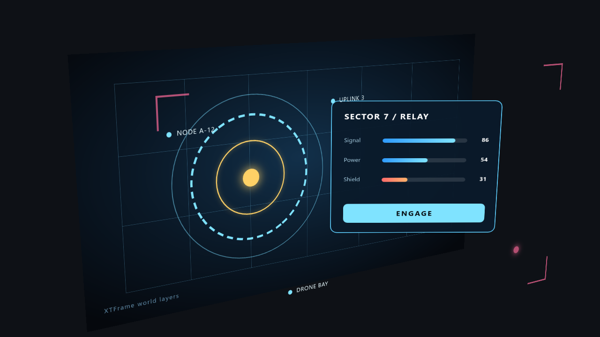

# world-layers



A 1280x720 UI made to be shown **layer by layer in a 3D scene** (`Docs/design/33-world-layers.md`):
five elements carry `world-layer: on`, each at its own depth, one of them tilted. A flat renderer
ignores the switch and draws the whole UI as one picture (the elements' 3D transforms projected by
`#Stage`'s `perspective`); in world-layer output every layer becomes its own texture plus the
transform of its plane in the root box, and a host -- here the viewer's own small camera -- puts
them into space.

```
world-layers/
  World Layers demo.xtui    spec: desktop 1280x720, logicalHeight 720
  stage/stage.xt            the document
  stage/stage.layout.xts    geometry and the layers' depths (translateZ, the panel's rotateY)
  stage/stage.xts           colours, the `world-layer` switches, three loops
```

| Layer | Element | Depth | Loop |
|---|---|---|---|
| base | `#Wall`, `#Caption` (everything without the switch) | 0 | |
| 1 | `#Grid` | 30 px | |
| 2 | `#Rings` | 90 px | the dashed ring turns: this layer is redrawn every frame |
| 3 | `#Panel`, turned 22 degrees | 160 px | |
| 4 | `#Tags` | 230 px | the layer floats out along z and flips: only its transform changes, nothing is redrawn |
| 5 | `#Fore` | 300 px | the layer pulses: only its opacity changes, nothing is redrawn |

See it standing up, without an engine (right-drag turns the camera, the wheel changes the depth
scale, the left button reaches the UI through the camera -- `ENGAGE` reacts to hover and press):

```
bin/win_x64/Debug/xtframe-view.exe Examples/demos/world-layers/stage/stage.xt --width 1280 --height 720 --layers-view
```

Write the layers out as a host gets them -- one PNG per layer, `layers.json` (id, order, the 4x4
`world3`, the rectangle on the layer plane, texture size, opacity, how often each layer was redrawn)
and `preview.png`:

```
bin/win_x64/Debug/xtframe-view.exe Examples/demos/world-layers/stage/stage.xt --width 1280 --height 720 --layers out/world-layers --frames 60
```

`--layers-yaw`, `--layers-pitch`, `--layers-depth` and `--layers-density` set the camera, the depth
scale and the textures' texels per px; `--renderer gl` uses OpenGL instead of WebGPU. The flat
picture of the same document:

```
bin/win_x64/Debug/xtframe-view.exe Examples/demos/world-layers/stage/stage.xt --width 1280 --height 720
```
